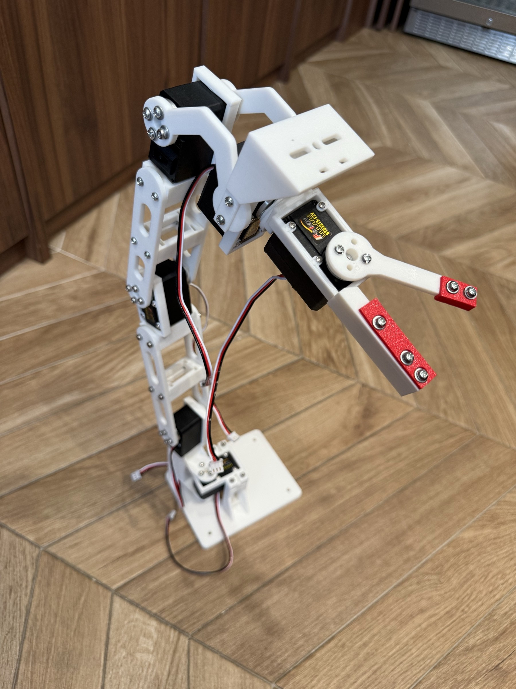
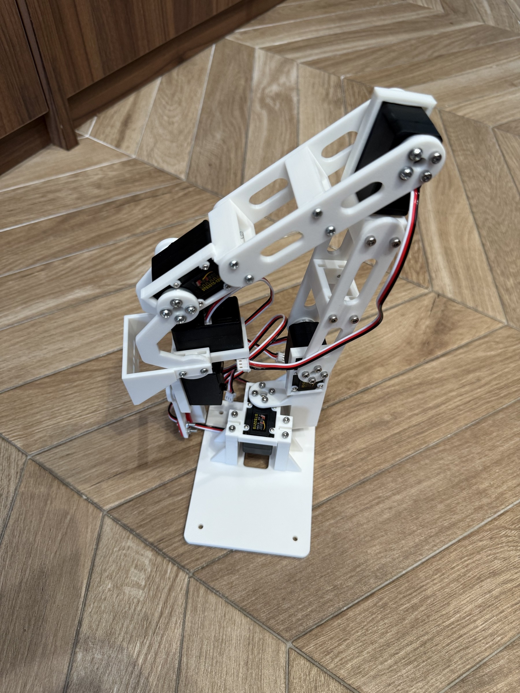
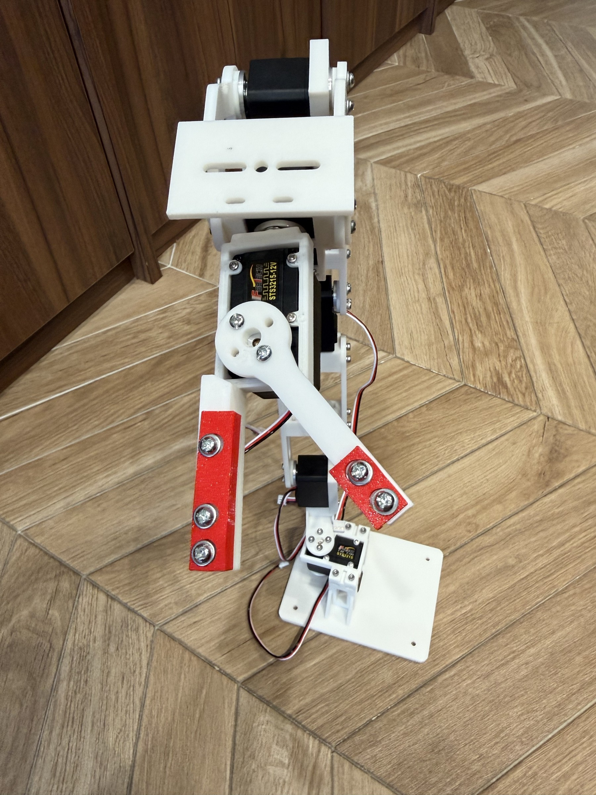
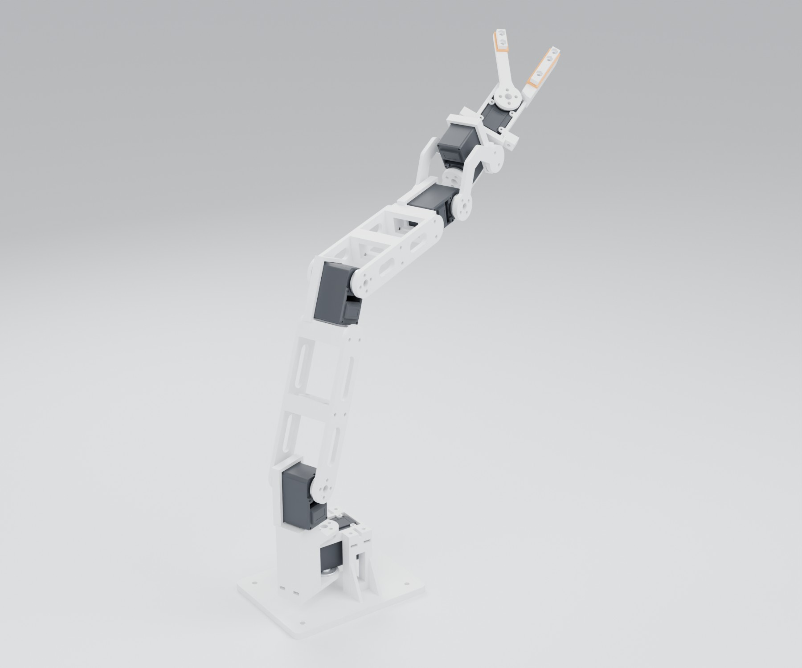
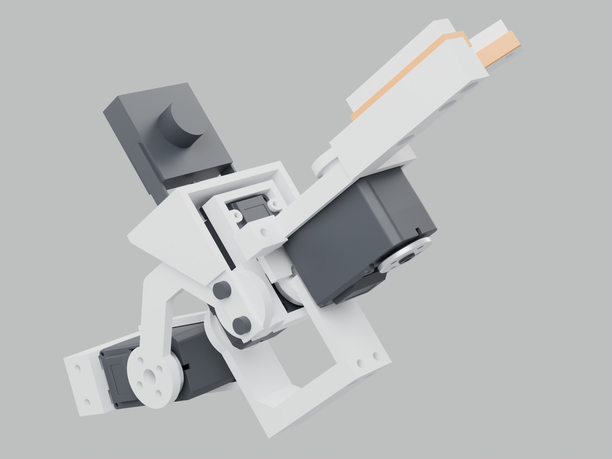
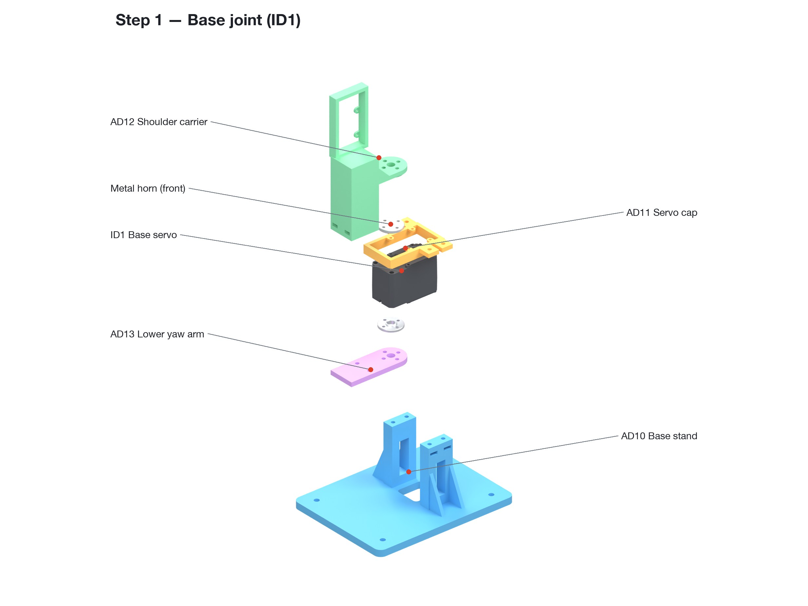
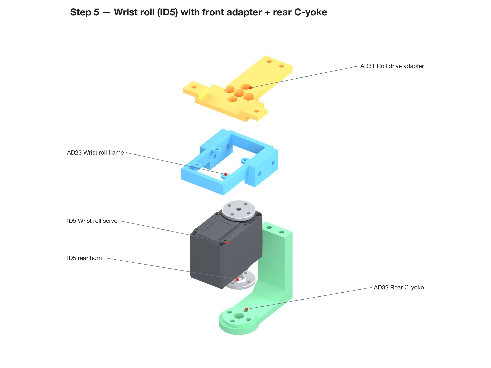

# ArmDojo Hardware

Open hardware from ArmDojo. The first design here is a **printable 5-axis desktop robot arm with a gripper**, driven by six Feetech STS3215 serial bus servos.

[](LICENSE)
[](https://makerworld.com/en/models/3421988-5-axis-desktop-robot-arm-for-sts3215-servos)
[](https://discord.gg/MdyRuJVFAm)

**💬 Questions, build help and show-and-tell: [join our Discord](https://discord.gg/MdyRuJVFAm).**

<p align="center">
  
  
  
</p>

<p align="center">
  
  
</p>

## The 5-axis arm (revision R5B)

| Servo ID | Joint |
|---|---|
| ID1 | Base yaw |
| ID2 | Shoulder |
| ID3 | Elbow |
| ID4 | Wrist pitch |
| ID5 | Wrist roll |
| ID6 | Gripper |

The layout started from the open-source [SO-ARM100 / SO-101](https://github.com/TheRobotStudio/SO-ARM100) arm by TheRobotStudio and Hugging Face. We then redesigned every printed part around the servo maker's own STS3215 dimensions. We printed, assembled and ran this exact version ourselves (photos above).

What's different:

- **Built to the servo's real dimensions:** every joint uses the 36.6 mm front-to-rear metal-horn contact span, the 9 mm horn boss clearance and the 20.7 × 20.5 mm case-screw pattern.
- **Driven on both sides:** every joint has twin plates on the front and rear horns.
- **Longer reach:** 165 mm from shoulder to elbow and 145 mm from elbow to wrist pitch.
- **Supported wrist roll:** a C-yoke (AD31 + AD32) holds the wrist-roll servo on both of its horns.
- **Removable gripper module:** it comes off with 2 screws.
- **Soft grip:** TPU 95A pads sit in grooves on the inner gripping faces, held by rigid PLA keepers.
- **Optional wrist camera platform:** AD28.
- **Base:** 130 × 100 mm, with four Ø4.5 mm holes on a 104 × 76 mm pattern.

## Repository layout

```
arm-r5b/
├── stl/                 23 parts, already in print orientation
├── step/                the same parts as STEP solids (print orientation)
├── print-profile/       Bambu Studio project for the Bambu Lab A1 0.4 mm nozzle (5 plates) + plate previews
├── docs/                assembly guide (PDF)
├── images/              renders, exploded assembly steps, photos of the built arm
└── PARTS_AND_PRINT_SETTINGS.txt   per-part orientation, supports, walls/infill, full hardware list
software/                control code (coming soon, see below)
```

## What you need

**Electronics**

- 6 × STS3215 servos, **12 V version (C018, 1:345 gear ratio)**, each with a front and a rear metal horn, a horn centre screw and 4 case screws. Available at [armdojo.com](https://armdojo.com/products/feetech-sts3215-serial-bus-servo), or as a [6-servo electronics kit](https://armdojo.com/products/so-101-single-arm-electronics-kit-feetech) that includes the adapter and cables.
- A 12 V servo power supply ([12 V 5 A](https://armdojo.com/products/servo-power-adapter-12v-5a-dc-5-5x2-1)).
- A USB bus-servo driver board ([Waveshare Bus Servo Adapter](https://armdojo.com/products/waveshare-bus-servo-adapter-board)).

**Screws and nuts** (no washers; pan or socket heads, not countersunk)

| Item | Qty | Notes |
|---|---|---|
| M3×6 | 4 | |
| M3×8 | 40 | |
| M3×10 | 6 | 2 if you fit the camera platform |
| M3×12 | 29 | 33 if you fit the camera platform |
| M3 hex nut | 35 | 5.5 mm AF, 2.4 mm thick, not nyloc |
| Servo metal horns | 11 | front + rear on ID1–ID5, front only on ID6 |
| Horn centre screws | 6 | |
| Servo case screws | 24 | |
| M4 bolts or clamps | 4 | to fix the base |

## Printing

- PLA Basic for 21 parts, plus 2 TPU 95A pads. AD16 is printed twice. AD17 and AD20 are the same shape, but both are needed.
- Fit-critical settings we used: 0.20 mm layers, XY hole/contour compensation 0, elephant-foot compensation 0.15 mm, outer walls 60 mm/s.
- Supports only on AD12, AD17, AD20, AD24 and AD31. Keep nut slots, 1.6 mm screw islands and horn contact faces free of support.
- The Bambu Studio project in [`arm-r5b/print-profile/`](arm-r5b/print-profile) has everything set up. It takes about 15 h and 303 g in total, or 14 h and 290 g without the camera plate.
- [`PARTS_AND_PRINT_SETTINGS.txt`](arm-r5b/PARTS_AND_PRINT_SETTINGS.txt) gives the orientation and settings for every part.

## Assembly

Follow the exploded step images in [`arm-r5b/images/assembly/`](arm-r5b/images/assembly) or the [assembly guide PDF](arm-r5b/docs/ArmDojo_5axis_arm_assembly_guide.pdf).

1. **Base (ID1):** put the nuts into AD10 and AD12 first. Build the servo, cap, AD12 and AD13 outside the base, then fix the stack into AD10.
2. **Shoulder (ID2):** screw the servo case into AD12 *before* the upper-arm plates go on. Fit AD14/AD15, then the AD16 brace at 60 mm.
3. **Elbow (ID3):** put the nuts into AD17 *before* the servo goes in. Fit the forearm plates AD18/AD19, then the second AD16 brace at 50 mm.
4. **Wrist pitch (ID4):** same as the elbow, with AD20.
5. **Wrist roll (ID5):** on the bench, put ID5 into AD23, then fit AD32 to the rear horn and AD31 to the front horn, and join AD31 to AD32.
6. **Side plates:** join ID4 to the wrist roll with AD21 (front) and AD22 (rear).
7. **Gripper pads:** fit the TPU pads AD26/AD27 and the keepers AD29/AD30.
8. **Gripper servo (ID6):** fix it into AD24, then mount the moving finger AD25 on its horn.
9. **Mount the gripper module** on AD31 with 2 × M3×12.
10. *(Optional)* **Camera platform:** fit AD28.

<p align="center"> </p>

**Before you power it on:**

- Use only 12 V servos (C018) on the 12 V supply.
- Set the IDs 1–6 and centre each servo before you fit its horns.
- For the first moves, keep the speed and torque limit low and the angles small.
- Wrist roll is designed for −90° to +90°. At zero the gripper pads are only about 0.4 mm apart.
- The arm has no payload rating, so don't hold it fully stretched out for long periods.

## Software (coming soon)

We are writing the control code now that our own arm is assembled. It will be open-sourced in [`software/`](software) in this repository. Follow progress on [Discord](https://discord.gg/MdyRuJVFAm).

## Community

- **Discord:** https://discord.gg/MdyRuJVFAm. Use the channels `#build-help`, `#printing`, `#software-control` and `#showcase`.
- **MakerWorld:** [3421988-5-axis-desktop-robot-arm-for-sts3215-servos](https://makerworld.com/en/models/3421988-5-axis-desktop-robot-arm-for-sts3215-servos). The print profile can be opened directly in Bambu Studio.
- Issues and pull requests are welcome.

## License

- **Hardware** (STL, STEP, 3MF, images, documents): [CC BY-NC-SA 4.0](LICENSE). You may share and adapt the files for non-commercial use, with attribution to ArmDojo, under the same license.
- **Upstream:** the design is partly derived from [SO-ARM100](https://github.com/TheRobotStudio/SO-ARM100) (Apache-2.0). See [NOTICE](NOTICE) and [LICENSE-Apache-2.0-upstream.txt](LICENSE-Apache-2.0-upstream.txt).
- **Software**, once published, will carry its own license in `software/`.
- The servo manufacturer's CAD is not included.
